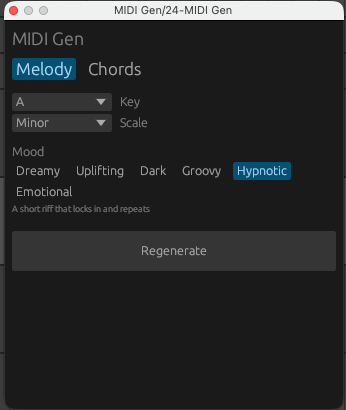

# MIDI Gen

A small VST3 plugin, written in Rust, that generates melodies or chord progressions as MIDI. Pick Melody or Chords, then a key, a scale, and a mood, and it plays a loop you can route to any instrument and record into a clip as starter material.

Built with [nih-plug](https://github.com/robbert-vdh/nih-plug) and its egui editor.



## What it does

- Generates either a **melody** or a **chord progression** in the key and scale you choose.
- Lets you pick the character by **mood** instead of technical settings.
- Plays one loop until you press **Regenerate**, so you can record it, tweak it, or roll a new one.
- Outputs plain MIDI. It makes no sound itself; route it to a synth.

## Controls

| Control | What it does |
|---|---|
| **Melody / Chords** | What kind of MIDI to generate. Switching generates a new loop. |
| **Key** | Root note (C to B). Changing it transposes the current loop. |
| **Scale** | Major, Minor, Dorian, Phrygian, Mixolydian, Harmonic Minor, or Minor Pentatonic. Changing it generates a new loop. |
| **Mood** | The character of the result (see below). Changing it generates a new loop. |
| **Regenerate** | Throws away the current loop and generates a new one. |

### Moods

| Mood | Melody | Chords |
|---|---|---|
| Dreamy | Sparse and floating, with long soft notes | Lush 9th chords that sustain and drift |
| Uplifting | Bright and rising, with bigger melodic jumps | Bright off-beat stabs, like classic house piano |
| Dark | Low, tense, and sparse | Sparse, moody 7th chord hits |
| Groovy | Busy, syncopated, and bouncy (default) | Syncopated deep house stabs |
| Hypnotic | A short riff that locks in and repeats | A two-chord vamp that rolls on repeat |
| Emotional | Slow, falling lines with long notes | Slow, wide 9th chords with space between the hits |

Each mood sets the technical details behind the scenes: how busy the rhythm is, note length, loudness, register, and so on, separately for each mode.

## How the melodies are made

Melodies are random, but constrained by simple composition rules, so they sound intentional rather than noisy.

1. **Rhythm.** One of 11 hand-written one-bar rhythms is chosen, weighted by the mood's density.
2. **Hook.** A short motif is built as a random walk through the scale: mostly steps, some thirds, rare leaps. A leap is usually followed by a step back. The contour is pulled toward the middle of the range and nudged up or down by the mood.
3. **Anchoring.** Notes on strong beats are often snapped to the tonic triad, so the melody feels rooted in the key. Off-beat notes are free to be passing tones.
4. **Call and response.** The hook ends on an unresolved degree (a "question"). Later bars reuse the hook as a transposed sequence or an exact return, and the final bar answers it by landing on the tonic and holding it.
5. **Playback.** The finished melody is stored as a fixed list of notes and looped, so it doesn't change while you record.

A random number generator seeded from the system clock provides the variety. Each plugin instance starts with a different result, and each press of Regenerate draws a new one.

## How the chords are made

Chords mode builds a four-chord loop (4 bars, or 8 for the slower moods) from common deep-house habits, and randomizes each layer so no two results are alike.

1. **Progression.** Picked from a library of common loops (i-VI-III-VII, i-iv-VII-III, i-VII-VI-VII, and in major I-vi-IV-V, ii-V-I-vi, and others), plus extras for Dorian, Phrygian, Mixolydian, and Harmonic Minor. The Hypnotic mood uses two-chord vamps (i-iv-i-iv). Sometimes the last chord is swapped for a turnaround (v or VII) that pulls back to the start. Progressions containing a diminished or augmented chord in the chosen scale are skipped.
2. **Chord colour.** Each chord is built by stacking thirds from the scale, so every mode gets its own natural chord qualities. Chords are triads, 7ths, or 9ths depending on the mood. The 5th is often dropped (root, 3rd, 7th, 9th is a very common deep-house voicing), and now and then the 3rd is replaced by a suspended 4th. Minor-major 7ths are avoided.
3. **Voicing and voice leading.** Every chord is placed in the same register, and the inversion that moves least from the previous chord is chosen, with randomness among near-ties. This gives the smooth, connected movement typical of piano and organ chords.
4. **Rhythm.** A stab pattern is chosen per result: sustained pads, off-beat house stabs, syncopated piano, or sparse hits. It repeats every bar, and the last bar sometimes switches to a different pattern as a turnaround. The slower moods roll the notes of each chord slightly (a gentle strum).

## Requirements

- [Rust](https://www.rust-lang.org/tools/install) (stable)
- macOS with Xcode Command Line Tools (the setup below is for Apple Silicon)
- A DAW that supports VST3 plugins with MIDI output (tested with Ableton Live)

## Build and install

```bash
# Build the VST3 bundle
cargo xtask bundle midi_gen --release

# Install it for the current user
cp -R target/bundled/midi_gen.vst3 ~/Library/Audio/Plug-Ins/VST3/
```

Then rescan plugins in your DAW. In Ableton Live, Option-click **Rescan** in Settings → Plug-Ins, and make sure **Use VST3 System Folders** is on.

To avoid copying after every build, you can add `target/bundled` as a custom VST3 folder in your DAW instead, and delete the copy in `~/Library/Audio/Plug-Ins/VST3/` so there aren't two versions.

## Using it in Ableton Live

1. Add **MIDI Gen** to a MIDI track.
2. Create a second MIDI track with an instrument (a synth).
3. On the second track, set **MIDI From** to the MIDI Gen track, and set the second dropdown to **MIDI Gen**.
4. Set the second track's **Monitor** to **In**.
5. Press play. The plugin only emits notes while the transport is running.

To capture a melody, arm the second track, enable record, and let it play. You get a normal MIDI clip you can edit in the piano roll. Pressing Regenerate while recording starts the new melody immediately, so for clean takes, regenerate first and then record.

## Troubleshooting

**Linker error about `unknown architecture arm64e.x1-macos` (or similar `.tbd` errors).**
The Command Line Tools SDK is newer than the installed linker. Point the build at an older SDK:

```bash
export SDKROOT=/Library/Developer/CommandLineTools/SDKs/MacOSX26.5.sdk
cargo clean
cargo xtask bundle midi_gen --release
```

Use whichever older SDK exists in `/Library/Developer/CommandLineTools/SDKs/`. To make it permanent, add the export to `~/.zshrc`, or set it under `[env]` in `.cargo/config.toml`.

**The plugin doesn't appear in the DAW.**
Search for the display name **MIDI Gen** (with a space), not `midi_gen`. Then Option-click Rescan in Live. If it still isn't listed, clear the quarantine flag and re-sign it:

```bash
xattr -cr ~/Library/Audio/Plug-Ins/VST3/midi_gen.vst3
codesign --force --deep --sign - ~/Library/Audio/Plug-Ins/VST3/midi_gen.vst3
```

**"This VST3 plug-in could not be opened" in Live.**
Check Live's log (`~/Library/Preferences/Ableton/Live <version>/Log.txt`) for lines mentioning `MIDI Gen`. Live rejects instrument-category plugins that don't declare a MIDI input bus, which is why the plugin sets `MIDI_INPUT` to `MidiConfig::Basic` even though it ignores incoming notes.

**No sound, or the notes don't reach the synth.**
Live's handling of VST3 MIDI output is limited. If MIDI Gen isn't listed as a source in the other track's **MIDI From** menu, test the plugin in a host with fuller support (Reaper, Bitwig) to confirm it works.

## Project structure

```
.
├── Cargo.toml          # crate config; nih_plug and nih_plug_egui from git
├── .cargo/config.toml  # `cargo xtask` alias
├── xtask/              # nih-plug bundler that produces the .vst3
└── src/
    ├── lib.rs          # plugin entry point: thin glue between nih-plug and the engine
    ├── params.rs       # host-visible parameters (key, scale, mood)
    ├── editor.rs       # the egui window
    ├── engine.rs       # playback: transport position -> timed MIDI events
    ├── melody.rs       # melody generation: rhythms, hook, call and response
    ├── chords.rs       # chord generation: progressions, voicing, stab rhythms
    ├── note.rs         # the note type shared by both generators
    ├── mode.rs         # Melody / Chords selector
    ├── mood.rs         # mood presets and the technical settings behind them (both modes)
    ├── theory.rs       # keys, scales, scale position -> MIDI note
    └── rng.rs          # tiny random number generator
```

Where to make changes:

- **New mood:** `mood.rs` only (add a variant, list it in `ALL`, fill in its labels, taglines, and settings for both modes).
- **New chord progressions or rhythms:** `chords.rs` (add entries to the progression or rhythm lists).
- **New scale:** `theory.rs` only (add a variant and its intervals, stable degrees, and open degrees).
- **New rhythms or melody rules:** `melody.rs`.
- **New control in the window:** add the parameter in `params.rs`, draw it in `editor.rs`, and pass its value into `BlockInput` in `lib.rs`.
- **New generator (for example a bassline):** add a variant in `mode.rs`, write a generator module that produces `Note`s (see `chords.rs`), and add a branch in `Engine::regenerate`. The engine has no nih-plug dependency, so it's easy to extend and reason about.

## Limitations

- Assumes 4/4 time.
- Melody and chords are generated separately. A melody isn't aware of the chords you play underneath it, so passing notes can clash.
- Chords have no bass note. Pair them with your own bassline, or add a bass mode.
- Only 11 rhythm templates, so patterns repeat across melodies.
- The loop is not saved with the project. Record it to a clip to keep it.

## Ideas for next steps

- Make the melody follow the generated chords (chord-aware melody).
- A bassline mode that follows the chord roots.
- Generate several candidate melodies internally and keep the best-scoring one.
- Follow the host's time signature.
- More rhythm templates and more moods.
- Export the current melody as a `.mid` file straight from the plugin.
